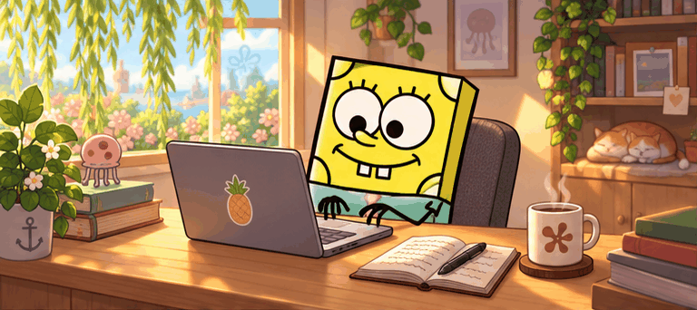

  

<h1 align="center">Hi! I'm Yuzhuo Wang. 👋</h1>

  <a href="https://github.com/TaveWang">GitHub · @TaveWang</a>

## 👋 About Me

- 🎓 Master of Computing student at **Australian National University**, specializing in Machine Learning.
- 🔬 Experience in computer vision, image segmentation, and LLM evaluation.

## 💻 Programming Languages

**Python** · **Java** · **SQL** · **Bash/Shell** · **R (basic)**
